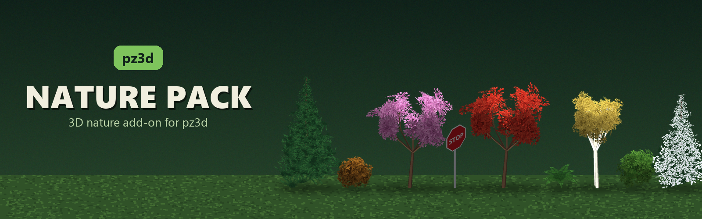
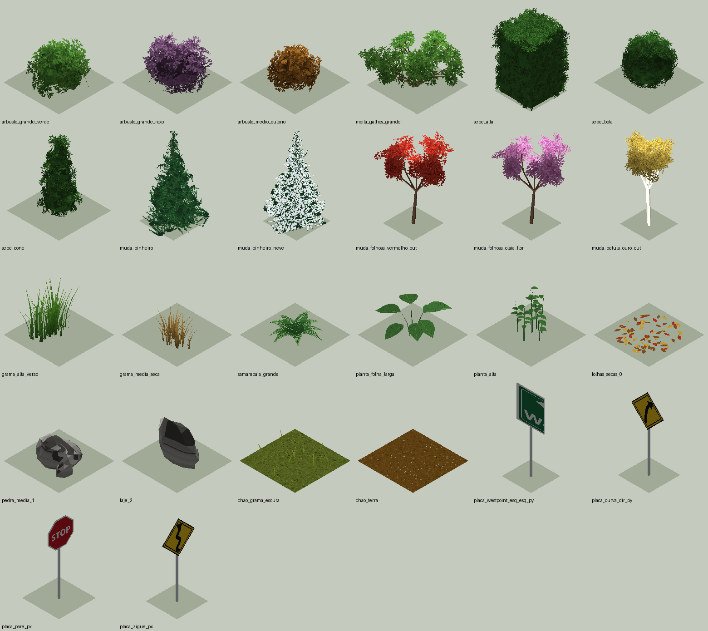
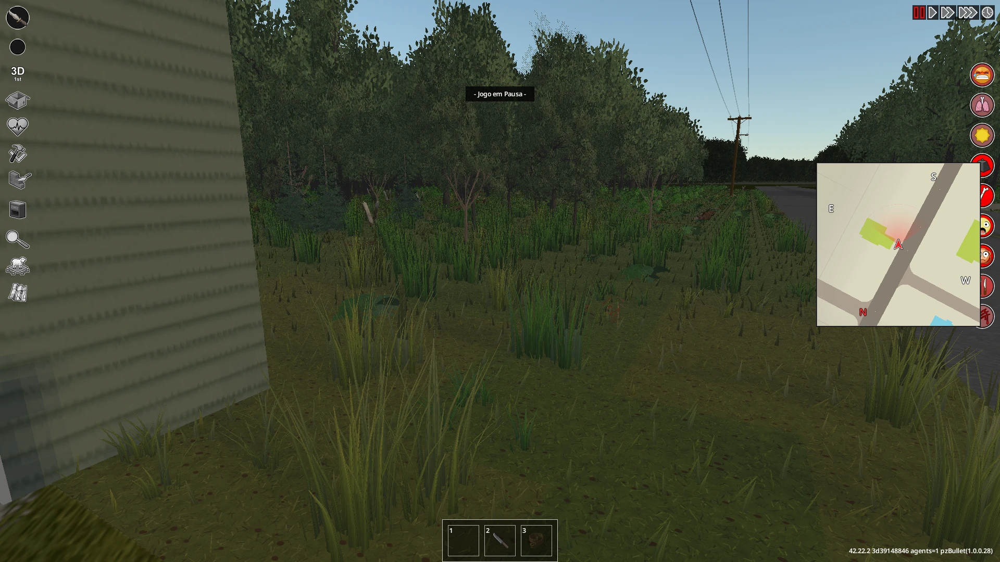
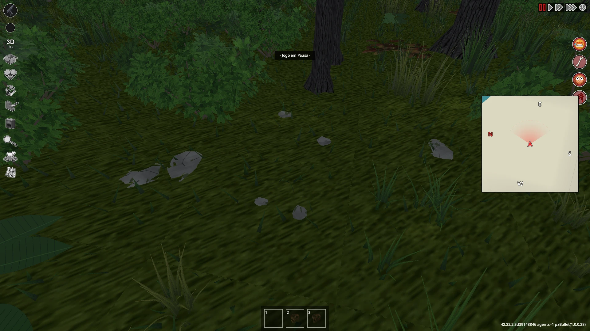
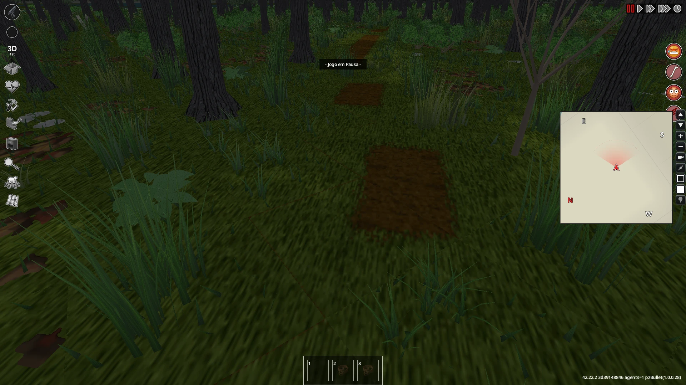
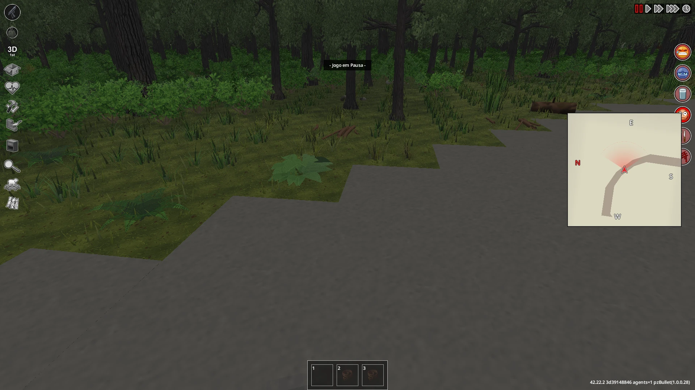
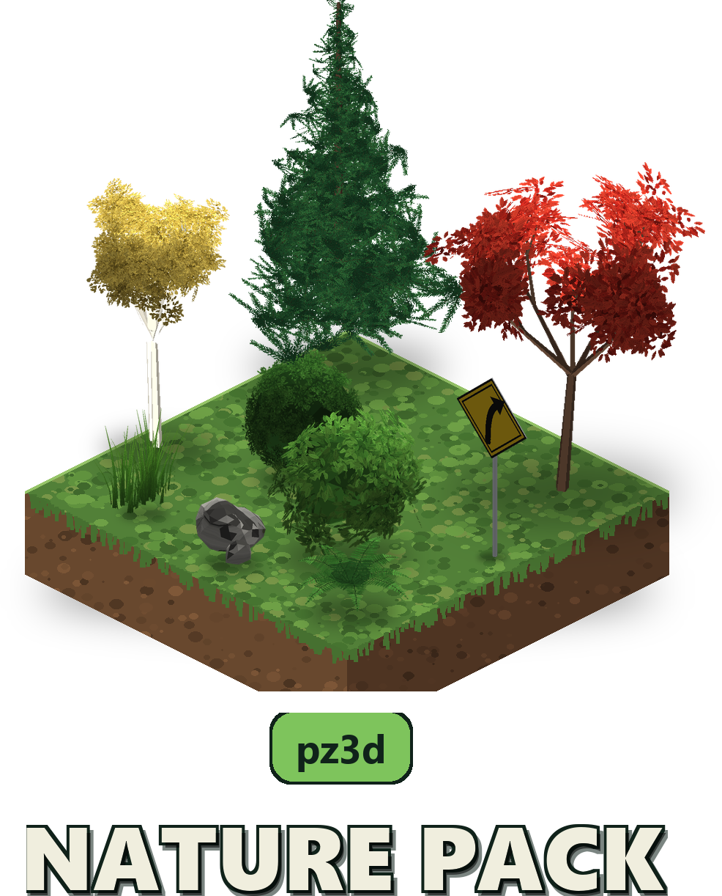

# pz3d Nature Pack



**Unofficial add-on for [pz3d](https://pz3d.dev) — Project Zomboid in 3D.**
It replaces the flat, sprite-based nature and road signs that pz3d still draws as cut-out planes with real textured 3D models.

> 🇧🇷 [Leia em português](#português)



| | |
|---|---|
|  |  |
|  |  |

## What it changes

| Group | What you get | Game tiles |
|---|---|---|
| Bushes & shrubs | Leaf-card foliage like pz3d's own trees, 3 sizes, 7 colour sets | `f_bushes_1`, `vegetation_foliage_01` |
| Forest shrubs | Low, open branchy shrubs; bare + snowy winter versions | `f_bushes_1` 0–31 |
| Hedges & topiary | Tall/low hedges, cone and ball topiary, snowy variants | `vegetation_ornamental_01`, `f_bushes_2` |
| Young trees | 9 species, follows the seasons (flowers, summer, two autumn stages, bare, snow), 4 growth sizes | `e_*_1` |
| Grass | Textured 3D blades in 5 seasonal tones (tall, medium, sparse) | `e_newgrass_1` |
| Ferns & plants | Real fronds, broad-leaf plants, seedlings, dry weeds, twigs | `d_generic_1`, `d_plants_1` |
| Natural ground | Seamless detailed grass/dirt/sand ground with short grass, colour-matched to the vanilla floor | `blends_natural_01` |
| Rocks | Chipped 3D boulders, slabs, pebbles and ground stones | `boulders` |
| Leaf litter | Loose dry leaves instead of a flat decal | `d_floorleaves_1` |
| Shoreline | River/lake edge pieces laid flat (pz3d draws them standing up) | `blends_natural_02` |
| Road signs | Sharp redrawn faces (curve warnings, STOP, town signs, rest area) | `street_roadsigns_01`, `street_decoration_01` 0–3 |

**205 models, 728 game tiles.** Everything is generated by code in this repo — no files from Project Zomboid or pz3d are copied or redistributed.

## Requirements

- Project Zomboid **Build 42.22.2**
- [pz3d](https://steamcommunity.com/sharedfiles/filedetails/?id=3807334881) **0.10.4** (which needs [ZombieBuddy](https://github.com/zed-0xff/ZombieBuddy) 2.3.4+)

## Install

**Steam Workshop (recommended):** subscribe to [pz3d Nature Pack](https://steamcommunity.com/sharedfiles/filedetails/?id=3840522104) and enable it together with pz3d in the game's Mods menu. Steam keeps it updated automatically.

Manual install:

1. Install and enable pz3d first (follow its own instructions).
2. Download `pz3d_naturepack-vX.Y.Z.zip` from [Releases](../../releases).
3. Extract it into `%USERPROFILE%\Zomboid\mods\` so you get `Zomboid\mods\pz3d_naturepack\42\mod.info`.
4. In the game's **Mods** menu enable **pz3d Nature Pack** together with pz3d.
5. Start the game. pz3d prepares the models on the main menu the first time (it takes a bit longer once).

## Build it yourself

```bash
pip install pillow numpy
python build.py            # writes dist/pz3d_naturepack, a release zip and a Steam Workshop folder
python build.py --install  # same, and copies the mod into %USERPROFILE%\Zomboid\mods
```

`generator/make_pack.py` holds every model; `generator/foliage.py` draws the textures (leaves, needles, grass, ground, rock, water) and has a small software renderer used for the previews; `generator/signs.py` draws the road sign faces.

## How it works

pz3d supports external model packs: an `assets.json` card list that binds an OBJ model to game tile names, the same system as pz3d's own chain-link fence example. This pack generates those cards. It found out along the way that pz3d accepts bindings for vegetation, floor tiles and signs, and that `map_Kd` textures with alpha are cut out cleanly — that is what makes leaf cards possible.

## Known limitations

- Shop signs and billboards (3000+ unique artworks) still use the game's low-res sprites.
- Beyond pz3d's model draw distance the vanilla ground and vegetation show; colours are matched so the switch is subtle.
- Grass-to-road edges keep the vanilla tile steps.
- The irregular dirt-patch blend tiles (`blends_natural_01` 112–127) are not replaced yet.
- Dense grass areas add a lot of geometry; on weaker PCs lower the grass density in `make_pack.py`.
- Built for pz3d 0.10.4 / PZ 42.22.2. pz3d is in early development and may change its model system.

## Credits

- **pz3d** by kolpaque — the 3D renderer this pack is made for. This project is not affiliated with pz3d.
- Logo, cover and banner are rendered from the pack's own models by `generator/branding.py`.
- **ZombieBuddy** by zed-0xff — Java mod loader used by pz3d.
- Project Zomboid by The Indie Stone.

## License

MIT — see [LICENSE](LICENSE). Use, fork and build on it freely.

---

## Português



**Complemento não oficial para o [pz3d](https://pz3d.dev), o Project Zomboid em 3D.**
Troca a vegetação, o chão natural, as pedras, a borda da água e as placas de trânsito, que o pz3d ainda desenha como planos recortados, por modelos 3D com textura.

### O que muda

- **Arbustos e moitas:** folhagem em cartões de folha, como as árvores do pz3d, em 3 tamanhos e 7 cores.
- **Sebes e topiários:** altos, baixos, cone e bola, com versões de neve.
- **Árvores jovens:** 9 espécies, acompanham as estações e os 4 tamanhos de crescimento.
- **Grama:** lâminas 3D com textura, em 5 tons de estação.
- **Samambaias, plantas, ervas secas e gravetos.**
- **Chão natural:** grama, terra e areia com textura detalhada e emendável, na mesma cor do piso original.
- **Pedras 3D, folhas secas soltas e borda de rio e lago deitada no chão.**
- **Placas de trânsito** redesenhadas e nítidas.

São 205 modelos para 728 tiles do jogo, todos gerados por código. Nenhum arquivo do jogo ou do pz3d é copiado.

### Requisitos

Project Zomboid **42.22.2**, [pz3d](https://steamcommunity.com/sharedfiles/filedetails/?id=3807334881) **0.10.4** e [ZombieBuddy](https://github.com/zed-0xff/ZombieBuddy) 2.3.4 ou mais novo.

### Instalação

**Steam Workshop (recomendado):** assine o [pz3d Nature Pack](https://steamcommunity.com/sharedfiles/filedetails/?id=3840522104) e ative junto com o pz3d no menu Mods do jogo. A Steam atualiza sozinha.

Manual:

1. Instale e ative o pz3d.
2. Baixe o `pz3d_naturepack-vX.Y.Z.zip` em [Releases](../../releases).
3. Extraia em `%USERPROFILE%\Zomboid\mods\`, de forma que fique `Zomboid\mods\pz3d_naturepack\42\mod.info`.
4. No menu **Mods** do jogo, ative o **pz3d Nature Pack** junto com o pz3d.

### Limitações conhecidas

- Placas de loja e outdoors, mais de 3 mil desenhos diferentes, continuam com o sprite do jogo.
- Depois da distância em que o pz3d para de desenhar modelos, aparecem o chão e a vegetação originais. As cores foram igualadas para a troca ficar suave.
- A emenda entre grama e asfalto continua em degraus de tile.
- Feito para pz3d 0.10.4 e PZ 42.22.2.

### Créditos e licença

O pz3d é do kolpaque, e este projeto não é afiliado a ele. O ZombieBuddy é do zed-0xff, e o Project Zomboid é da The Indie Stone. Licença MIT.
